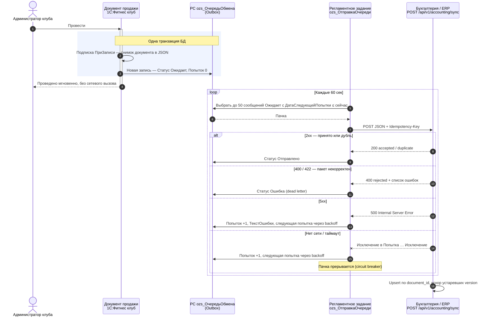
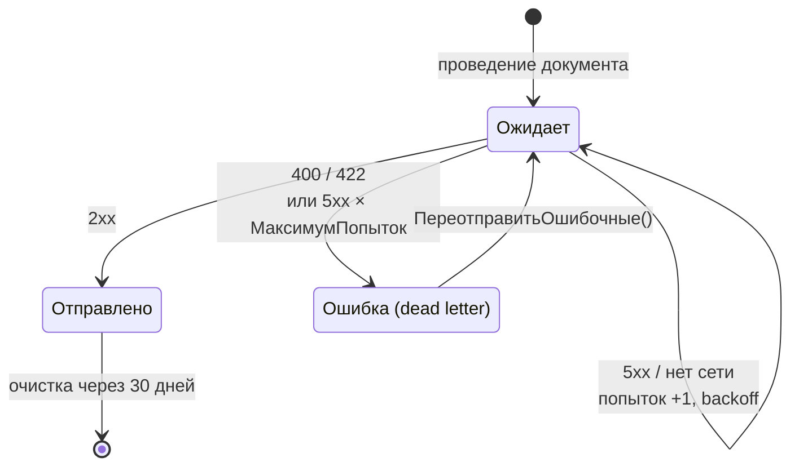

# Ozen-Sync

**Отказоустойчивая интеграционная шина «1С:Фитнес клуб» → 1С:Бухгалтерия / внешняя ERP.**
HTTP REST + JSON, паттерн Transactional Outbox, экспоненциальный бэкофф, идемпотентный приёмник.


---

## Проблема

Типовая интеграция «при проведении — сразу POST в бухгалтерию» ломается тремя способами:

1. **Потеря данных.** Сеть моргнула — документ проведён в клубе, но в бухгалтерию не попал.
   Расхождение всплывает при сверке через месяц.
2. **Зависший интерфейс.** Администратор на ресепшене ждёт 15–30 сек таймаута на каждой продаже,
   пока бухгалтерия недоступна. Очередь клиентов растёт.
3. **Дубли и рассинхрон.** Ответ `200` потерялся — 1С повторила запрос — в бухгалтерии две реализации.
   Или старая версия документа, застрявшая в повторах, перезаписала новую.

## Решение

| Проблема | Механизм |
|---|---|
| Потеря данных | **Transactional Outbox.** Сообщение пишется в регистр сведений в той же транзакции, что и документ (подписка `ПриЗаписи`). Либо есть и документ, и сообщение, либо ничего. |
| Зависший интерфейс | Проведение не делает сетевых вызовов. Доставкой занимается регламентное задание раз в 60 сек. |
| Временные сбои | Повтор с **экспоненциальной задержкой и джиттером**: 30 с → 1 мин → 2 мин → … → потолок 1 ч. |
| Лавина запросов при недоступности | **Circuit breaker:** первая сетевая ошибка прерывает пачку — не ждём таймаут 50 раз. |
| Битые пакеты | `400/422` → сразу в статус `Ошибка` (dead letter). Повтор не поможет, нужен человек. |
| Дубли | **At-least-once + идемпотентность.** Заголовок `Idempotency-Key` = ID сообщения, приёмник дедуплицирует. |
| Порядок версий | Пакет — полный снимок с монотонной `version`; приёмник игнорирует устаревшие снимки. |
| Распроведение | Сообщение с `operation: cancel`, если документ уже был выгружен. |

## Поток данных



### Жизненный цикл сообщения



Сетевые ошибки никогда не переводят сообщение в `Ошибка`: недоступность сервиса — не вина
сообщения. Даже многодневный простой бухгалтерии закончится автоматической досылкой.

## Состав репозитория

```text
1c/
  METADATA.md                         метаданные расширения и сборка .cfe
  src/CommonModules/
    ozs_ОчередьОбмена/                подписка ПриЗаписи, сериализация JSON (Задача 1)
    ozs_ОтправкаВБухгалтерию/         HTTP-клиент, повторы, бэкофф, dead letter (Задача 2)
    ozs_ОбменСБухгалтериейНастройки/  адрес сервиса, размер пачки, политика повторов
emulator/                             FastAPI-эмулятор бухгалтерии (Задача 3)
  app/schemas.py                      контракт (Pydantic v2)
  app/store.py                        идемпотентное хранилище
  app/main.py                         эндпоинты, имитация сбоев
  tests/test_api.py                   32 теста контракта и гарантий
tools/outbox_simulator.py             порт логики отправки 1С на Python + SQLite
docs/
  api-contract.md                     контракт API v1
  TESTING.md                          сценарии Тестов 1–3 и фактические результаты
  payload-example.json
```

## Быстрый старт

Эмулятор бухгалтерии:

```bash
cd emulator && python -m venv .venv && .venv/Scripts/pip install -r requirements-dev.txt
```

```bash
cd emulator && .venv/Scripts/python -m uvicorn app.main:app --port 8000
```

Swagger UI: <http://localhost:8000/docs>. Доля сбоев — `OZEN_FAILURE_RATE` (по умолчанию `0.2`),
меняется на лету через `PUT /api/v1/admin/chaos`. Или в Docker:

```bash
docker build -t ozen-emulator emulator && docker run -p 8000:8000 ozen-emulator
```

Тесты контракта:

```bash
cd emulator && .venv/Scripts/python -m pytest -q
```

Сценарий отказа без 1С (эмулятор выключен → накопление → включение → досылка):

```bash
python tools/outbox_simulator.py enqueue --count 10 --invalid 1
```

```bash
python tools/outbox_simulator.py run --until-empty --interval 1
```

1С: соберите расширение по [1c/METADATA.md](1c/METADATA.md), в `ozs_ОбменСБухгалтериейНастройки`
укажите адрес эмулятора.

## Тестирование

| Тест | Что доказывает | Как проверено |
|---|---|---|
| 1. Outbox | Проведение атомарно создаёт сообщение с валидным JSON и не ждёт сеть | Ручной сценарий в 1С; JSON проверяется `POST /api/v1/accounting/validate` |
| 2. Resilience | Сбои не роняют 1С, попытки копятся, после восстановления всё досылается ровно один раз | Ручной сценарий в 1С + прогон симулятора: 10 сообщений, 7 искусственных 500, 9 доставлено по 1 разу, 1 битое — в dead letter |
| 3. API contract | Некорректные пакеты отсекаются с понятной ошибкой | 32 автотеста pytest |

Подробно — [docs/TESTING.md](docs/TESTING.md).

## Политика повторов

`задержка = min(30 с × 2^(n−1), 3600 с) + джиттер 0–20%`

| Попытка | 1 | 2 | 3 | 4 | 5 | 6 | 7 | 8+ |
|---|---|---|---|---|---|---|---|---|
| Пауза после неё | 30 с | 1 мин | 2 мин | 4 мин | 8 мин | 16 мин | 32 мин | 1 ч |

После 10 HTTP-ошибок (5xx и прочие 4xx) — `Ошибка`. Сетевые ошибки лимитом не ограничены.

## Архитектурные решения

- **Регистр сведений, независимый, а не по регистратору.** Статус сообщения меняет фоновое задание,
  а не перепроведение документа; набор записей регистратора перезаписывался бы при каждом проведении.
- **Снимок, а не дельта.** Каждое сообщение самодостаточно, приёмник делает upsert. Потеря или
  переупорядочивание промежуточных сообщений не ломает итоговое состояние.
- **Отправка вне транзакции, фиксация результата — в короткой транзакции с управляемой блокировкой**
  по ключу сообщения. HTTP-вызов внутри транзакции держал бы блокировки до таймаута.
- **Регламентное задание вместо фонового задания из `ПриЗаписи`.** Платформа не запускает второй экземпляр
  регламентного задания, пока работает первый, — одно сообщение не отправляется двумя потоками.
- **Отклонение от ТЗ:** `400/422` не повторяются, а сразу уходят в `Ошибка`. Повтор пакета,
  который приёмник признал некорректным, гарантированно даст тот же результат и засорит очередь.

## Что дальше для продакшена

- Настройки — в константы / регистр, токен — в `БезопасноеХранилищеДанных`.
- Форма мониторинга очереди с кнопкой «Переотправить» и уведомление при росте `Ошибка` или возрасте
  старейшего `Ожидает` > N минут (`ozs_ОтправкаВБухгалтерию.СостояниеОчереди()` уже возвращает метрики).
- Персистентное хранилище ключей идемпотентности на приёмнике (сейчас in-memory).
- Обратный канал: `accounting_entry_id` из ответа — в реквизит документа клуба.
